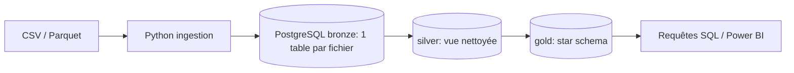
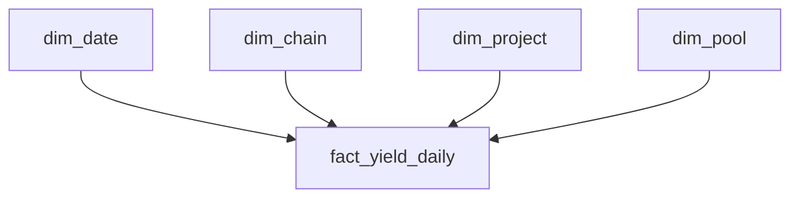

# DeFi Pools — SQL & Modélisation en étoile

Projet personnel sur PostgreSQL, à partir de fichiers CSV et Parquet issus du dataset DeFi Daily (Kaggle, source originale DefiLlama). Le code est versionné sur GitHub sans cloner d'ancien dépôt.

**Question métier :** « Quels pools DeFi présentent le meilleur compromis entre rendement (APY), liquidité (TVL) et indicateurs de risque, selon les blockchains et les protocoles ? »

**Limites des données :** le schéma observé des snapshots Yield Pools comprend `snapshot_date`, `pool_id`, `chain`, `project`, `symbol`, `pool_meta`, `tvl_usd`, `apy`, `apy_base`, `apy_reward`. Il ne montre pas `il_risk`, `stablecoin` ou `category`. Le modèle initial permet une analyse APY/TVL; l'axe « risque » exige des attributs complémentaires vérifiés. Il faut également vérifier l'étendue réelle des dates avant de promettre 45 jours de tendances.

## Architecture





## Publication sur GitHub (sans `git clone`)

1. Sur [github.com/new](https://github.com/new), créer un dépôt personnel **`defi_pools`**. Le définir en **Public** (ou accorder explicitement l'accès à l'enseignant). **Ne pas cocher** les options pour créer automatiquement README / `.gitignore` / licence : le dépôt distant doit être vide.
2. Décompresser ce projet, ouvrir le dossier `defi_pools` dans VS Code, puis exécuter dans son terminal :

   ```bash
   git init
   git branch -M main
   git add .
   git commit -m "Initial DeFi analytics project"
   git remote add origin https://github.com/camel-lion-child/defi_pools.git
   git push -u origin main
   ```

   Remplacer `VOTRE_IDENTIFIANT` par votre pseudo GitHub. Si GitHub demande une authentification, utiliser la connexion navigateur ou les identifiants/jetons GitHub adaptés ; **ne pas mettre de jeton dans le code**.
3. Vérifier sur la page du dépôt que `README.md`, `scripts/` et `sql/` apparaissent. Partager **l'URL du dépôt** avec l'enseignant.
4. Pour sauvegarder de nouvelles modifications : `git add . && git commit -m "Add SQL analyses" && git push`.

**Important :** `.gitignore` exclut `.env`, `.venv/` et les données dans `data/`. Les CSV/Parquet ne sont donc pas publiés automatiquement. L'enseignant peut reproduire le pipeline après téléchargement du [dataset Kaggle](https://www.kaggle.com/datasets/danielaijdkx/defi-daily-tvl-stablecoins-dex-yields) dans `data/`.

## Démarrage (Mac, VS Code)

1. Créer une nouvelle base `defi_pools` depuis une requête PostgreSQL connectée à la base par défaut `postgres` : ouvrir `sql/00_create_database.sql`, exécuter une fois. Ne jamais modifier l'ancienne base `datawarehouse`.
2. Ouvrir ce dossier décompressé dans VS Code.
3. Copier vos 12 fichiers CSV / Parquet dans `data/` (ne pas convertir les Parquet).
4. Copier `.env.example` vers `.env`, corriger `PGUSER` et le mot de passe éventuel. Vérifier l'hôte/port. `.env` reste local et ne doit pas être partagé.
5. Terminal à la racine du projet :

   ```bash
   python3 -m venv .venv
   source .venv/bin/activate
   python -m pip install -r requirements.txt
   python scripts/01_import_bronze.py
   ```

6. Dans Database Client, connecter la **nouvelle** base `defi_pools` et exécuter, dans cet ordre :
   - `sql/01_check_bronze.sql` : nombre de tables, dates, doublons.
   - `sql/02_build_star.sql` : créer Silver (vue) et Gold (1 table de faits + 4 dimensions).
   - `sql/03_analysis.sql` : requêtes analytiques, une par une.
   - `sql/04_performance.sql` : EXPLAIN ANALYZE avant/après index.

## Sécurité et limites

- Le script d'import refuse de se connecter à toute base autre que `defi_pools`. Il ignore les tables Bronze déjà existantes, sans les écraser.
- Les champs Bronze sont importés en `TEXT` pour préserver les valeurs sources. Silver convertit les dates et mesures numériquement; les valeurs non numériques deviennent `NULL` dans les mesures, à examiner.
- Le script Gold **recrée uniquement les tables Gold** lorsque relancé. Il échoue sur les doublons `(date, pool_id)` afin d'éviter de fausser les KPI.
- Il peut exister des erreurs de format dans les fichiers réels ; consulter les requêtes de vérification avant de construire Gold.
- `latest`, `history` et `snapshots` ne doivent pas être fusionnés automatiquement: risque de doublons et granularités différentes.
- `APY` est un pourcentage : ne pas sommer les APY. Un APY élevé ne signifie pas un placement sans risque. `TVL` n'est pas une mesure exhaustive du risque.
- La documentation, les tests dbt et l'enrichissement éventuel du risque peuvent être ajoutés plus tard selon le barème du cours.
