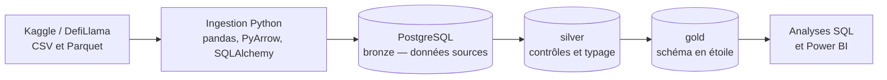
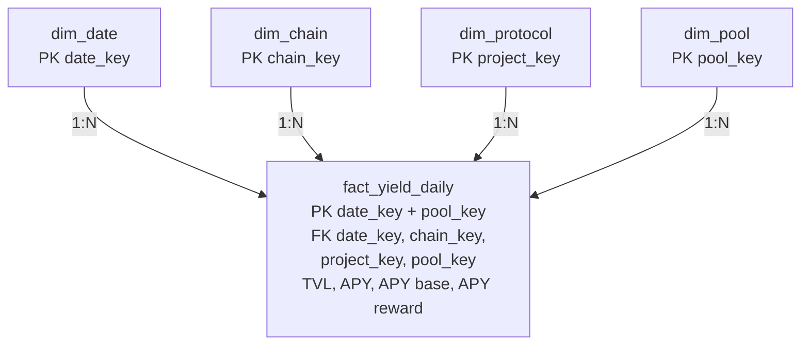

# DeFi Pools — Pipeline PostgreSQL, SQL avancé et modélisation décisionnelle

**Projet individuel | Mastère 1 — Ingénierie des données & pipelines SQL**

## 1. Contexte et problématique métier

Ce projet étudie les données de la finance décentralisée (*Decentralized Finance*, DeFi) à partir d'un pipeline de données construit dans PostgreSQL. Il met en pratique la modélisation relationnelle, les requêtes SQL avancées, l'analyse des performances et la modélisation en étoile.

**Question métier :**

> Quels pools de rendement DeFi présentent le meilleur compromis observable entre rendement (APY) et liquidité (TVL), selon les blockchains et les protocoles, et comment ce compromis évolue-t-il dans le temps ?

L'analyse vise à comparer les pools sans produire de recommandation d'investissement. L'APY exprime un rendement annualisé indicatif ; la TVL mesure les actifs déposés, mais aucun de ces indicateurs ne suffit à évaluer le risque financier d'un placement.

## 2. Origine et description des données

- **Dataset :** [DeFi Daily: TVL, Stablecoins, DEX & Yields — Kaggle](https://www.kaggle.com/datasets/danielaijdkx/defi-daily-tvl-stablecoins-dex-yields)
- **Source originale annoncée :** DefiLlama.
- **Formats :** CSV et Parquet.
- **Périmètre :** TVL des blockchains et des protocoles, stablecoins, frais des DEX et pools de rendement.
- **Jeu principal pour la question métier :** `yield_pools_snapshots.parquet`.

Les données sont organisées en fichiers `latest`, `history` et `snapshots`. Ces fichiers ne sont pas fusionnés sans contrôle : ils peuvent représenter des granularités ou des périodes différentes. Les conditions de licence et de réutilisation du dataset sont à confirmer auprès de la source.

## 3. Architecture du pipeline — Medallion

Le traitement suit l'architecture **Bronze → Silver → Gold**, avec séparation des données sources, des transformations et de la restitution analytique.



| Couche | Objet | Réalisation |
|---|---|---|
| **Bronze** | Conserver la structure des fichiers d'origine | Import de chaque CSV/Parquet dans une table `bronze.*` ; champs chargés en texte pour préserver les valeurs sources. |
| **Silver** | Préparer des données exploitables | Vue `silver.yield_pools_clean` : conversion des dates et des mesures, nettoyage des identifiants et contrôle des doublons. |
| **Gold** | Répondre à la question métier | Dimensions et table de faits dans `gold`, avec clés primaires, étrangères et contraintes. |

## 4. Modélisation relationnelle et schéma en étoile

Le modèle décisionnel est centré sur la table de faits `gold.fact_yield_daily`.

**Granularité (*grain*) :** une observation par pool et par date, identifiée par la clé composée `(date_key, pool_key)`.



| Table Gold | Rôle |
|---|---|
| `dim_date` | Date d'observation, année, mois, jour. |
| `dim_chain` | Blockchain. |
| `dim_protocol` | Projet / protocole référencé dans les données de pools. |
| `dim_pool` | Identifiant du pool et symbole. |
| `fact_yield_daily` | Mesures de liquidité (`tvl_usd`) et de rendement (`apy`, `apy_base`, `apy_reward`). |

Les clés étrangères assurent l'intégrité référentielle et la clé primaire composée empêche plusieurs observations d'un même pool pour une même date dans la table Gold. Les contrôles Bronze/Silver sont réalisés avant le chargement afin d'éviter les duplications et les agrégations trompeuses.

## 5. Requêtes SQL et analyses métier

Les requêtes sont construites autour de la même question métier. Elles mobilisent les concepts étudiés en cours : jointures, sous-requêtes, agrégations, `GROUP BY` / `HAVING`, fonctions de fenêtre et CTE récursives.

| Analyse | Techniques SQL | Interprétation |
|---|---|---|
| Classement des pools par blockchain | `JOIN`, `CTE`, `RANK()` ou `DENSE_RANK()` | Comparer les meilleurs APY sous contrainte de TVL minimale. |
| Variation du rendement entre observations | `LAG()`, `PARTITION BY` | Étudier la hausse ou la baisse de l'APY d'un pool. |
| Moyenne mobile du rendement | `AVG() OVER`, `ROWS BETWEEN` | Lisser la série sur sept **observations**, pas nécessairement sept jours calendaires. |
| Segmentation par liquidité | `NTILE(4)` | Comparer les quartiles de TVL par blockchain. |
| Poids des pools dans leur blockchain | `SUM() OVER (PARTITION BY ...)` | Mesurer la part de TVL parmi les pools présents dans le dataset. |
| Dates manquantes dans l'historique | `WITH RECURSIVE`, `LEFT JOIN` | Construire un calendrier de 45 jours et détecter les jours sans observation. |

Le script `sql/03_analysis.sql` contient également des analyses de synthèse (APY moyen, APY pondéré par la TVL, APY base / reward et sous-requête corrélée). Le livrable demandé `sql/02_requetes_avancees.sql` regroupe six requêtes avancées, **chacune précédée de sa question métier en commentaire** ; son ajout au dépôt et son exécution sont à vérifier.

## 6. Volumétrie, indexation et performances

Pour étudier les performances sans altérer les observations réelles, le protocole de benchmark prévoit un **jeu de données synthétique d'environ 10 millions de lignes**, séparé des couches analytiques dans le schéma `benchmark`.

1. **Génération :** `sql/01_generation_volume.sql`, avec clés primaires et étrangères cohérentes avec les dimensions Gold.
2. **Mesure initiale :** sélectionner trois requêtes coûteuses ; effectuer trois exécutions par requête et conserver la **médiane** ainsi que les plans `EXPLAIN (ANALYZE, BUFFERS)`.
3. **Optimisation :** créer les index justifiés par les prédicats et les plans dans `sql/03_index.sql`, puis exécuter `ANALYZE`.
4. **Nouvelle mesure :** exécuter les mêmes requêtes, trois fois chacune, dans des conditions comparables.
5. **Restitution :** documenter les plans, les temps médians, les écarts avant/après et leurs limites dans `docs/rapport_performance.md`.

Les éventuels gains de performance doivent être établis à partir de mesures réelles, **sans résultats chiffrés inventés**. Les lignes synthétiques servent exclusivement à l'étude de la volumétrie et ne sont pas utilisées pour le classement métier des pools.

## 7. Industrialisation avec dbt

Le module prévoit une industrialisation des transformations avec **dbt-postgres** : modèles `staging` puis `marts`, tests (`unique`, `not_null`, `relationships`) et documentation générée. Cette partie constitue un **livrable complémentaire à implémenter / publier** ; le pipeline SQL PostgreSQL présenté ici ne doit pas être confondu avec un projet dbt déjà finalisé.

## 8. Stack technique

| Outil | Usage |
|---|---|
| PostgreSQL | Base relationnelle, contraintes, transformations SQL et benchmark. |
| Python, pandas, PyArrow, SQLAlchemy | Lecture des CSV/Parquet et ingestion Bronze. |
| VS Code / Database Client | Développement et exécution des scripts. |
| Git / GitHub | Versionnement et dépôt des livrables. |
| dbt-postgres | Industrialisation et tests des modèles (à finaliser). |
| Power BI | Visualisation des indicateurs construits dans Gold (livrable cible). |

## 9. Organisation du dépôt

Les fichiers déjà publiés et les livrables complémentaires attendus sont distingués ci-dessous :

```text
defi_pools/
├── README.md
├── .gitignore
├── .env.example
├── requirements.txt
├── data/                         # Données sources exclues de Git
├── scripts/
│   ├── 01_import_bronze.py
│   ├── 02_benchmark.py          # Complément à publier
│   └── 03_make_report.py        # Complément à publier
├── sql/
│   ├── 00_create_database.sql
│   ├── 01_check_bronze.sql
│   ├── 02_build_star.sql
│   ├── 03_analysis.sql
│   ├── 04_performance.sql
│   ├── 01_generation_volume.sql # Complément à publier
│   ├── 02_requetes_avancees.sql # Complément à publier
│   └── 03_index.sql             # Complément à publier
└── docs/                         # À compléter
    └── rapport_performance.md   # À produire à partir des mesures réelles
```

L'arborescence sera mise à jour après l'ajout des livrables de benchmark et, le cas échéant, du projet dbt.

## 10. Reproductibilité

L'environnement local est configuré à partir du modèle `.env.example`, sans publier de mot de passe. Les données brutes doivent être téléchargées depuis la source Kaggle et placées dans `data/`.

```bash
python3 -m venv .venv
source .venv/bin/activate
python -m pip install -r requirements.txt
python scripts/01_import_bronze.py
```

Dans PostgreSQL, exécuter ensuite les scripts de contrôle (`01_check_bronze.sql`), de construction du modèle (`02_build_star.sql`) et d'analyse (`03_analysis.sql`). Le benchmark à 10 millions de lignes est exécuté séparément, après validation du modèle Gold.

## 11. Limites et démarche critique

- Les colonnes `il_risk`, `stablecoin` et `category` ne figurent pas dans le schéma Yield Pools utilisé pour construire le modèle Gold actuel. Une analyse explicite des risques demanderait un enrichissement documenté et contrôlé.
- La profondeur historique doit être vérifiée avant d'interpréter une tendance sur 45 jours. Une moyenne sur sept observations ne garantit pas sept jours consécutifs.
- La somme des TVL des pools présents dans le dataset **n'est pas** la TVL totale d'une blockchain ; un contrôle de périmètre est nécessaire avant toute comparaison.
- L'APY est un taux : il ne doit pas être sommé. Un rendement élevé ou une TVL élevée ne garantissent pas la sécurité d'un protocole.
- Les résultats du benchmark dépendent du volume, des index, du cache, de l'environnement et des plans retenus ; ils doivent être interprétés, pas seulement présentés comme des chiffres.

**Dépôt du projet :** https://github.com/camel-lion-child/defi_pools
