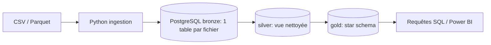
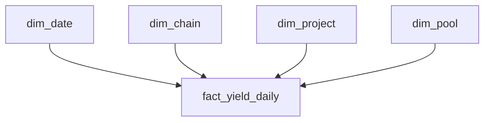

# DeFi Pools — SQL & Modélisation en étoile

Projet personnel sur PostgreSQL, à partir de fichiers CSV et Parquet issus du dataset DeFi Daily (Dataset Kaggle : https://www.kaggle.com/datasets/danielaijdkx/defi-daily-tvl-stablecoins-dex-yields, source originale DefiLlama). Le code est versionné sur GitHub sans cloner d'ancien dépôt.

**Question métier :** « Quels pools DeFi présentent le meilleur compromis entre rendement (APY), liquidité (TVL) et indicateurs de risque, selon les blockchains et les protocoles ? »

**Limites des données :** le schéma observé des snapshots Yield Pools comprend `snapshot_date`, `pool_id`, `chain`, `project`, `symbol`, `pool_meta`, `tvl_usd`, `apy`, `apy_base`, `apy_reward`. Il ne montre pas `il_risk`, `stablecoin` ou `category`. Le modèle initial permet une analyse APY/TVL; l'axe « risque » exige des attributs complémentaires vérifiés. Il faut également vérifier l'étendue réelle des dates avant de promettre 45 jours de tendances.

## Architecture

